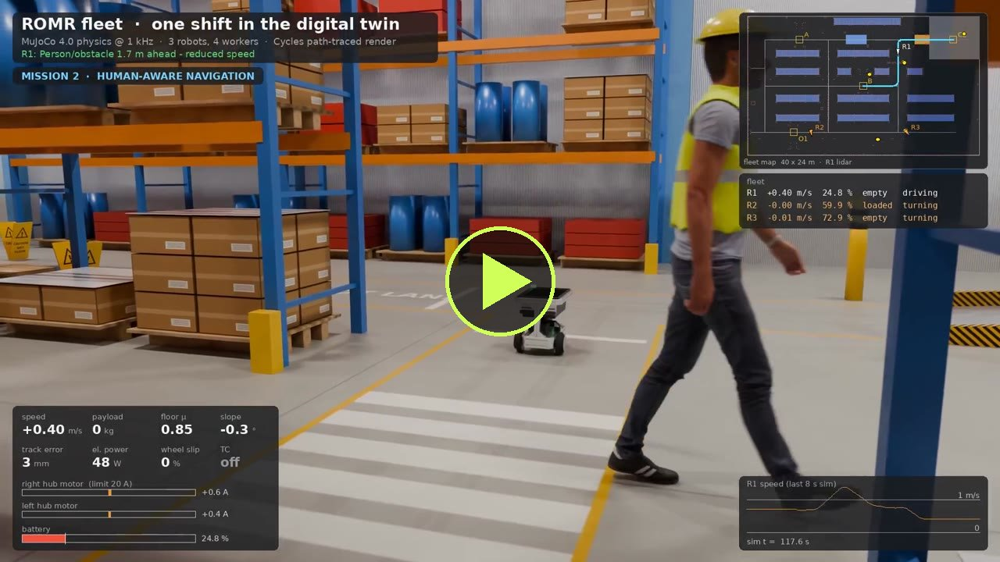

## ROMR: A ROS-Based Open-Source Mobile Robot
[](https://linusnep.github.io/ROS-Mobile-Robot/)
[](http://www.ros.org/)
[](https://index.ros.org/doc/ros2/)
[](https://www.gnu.org/licenses/gpl-3.0.en.html)
[](https://doi.org/10.1016/j.ohx.2023.e00426)
[](https://linusnep.github.io/ROS-Mobile-Robot/#digital-twin)
[](https://github.com/LinusNEP/ROS-Mobile-Robot/commits)

ROMR is an open-source, low-cost, high-payload autonomous platform designed for research, logistics, and education. This repository contains the necessary files for its design and development. ROMR utilises off-the-shelf (OTS) components, additive-manufactured parts, aluminium profiles, and a consumer hoverboard with high-torque brushless direct current (BLDC) motors. It is fully compatible with the robot operating system (ROS), has a maximum payload of 90kg, and costs less than $1500. Furthermore, ROMR offers a simple yet robust framework for contextualising simultaneous localisation and mapping (SLAM) algorithms, an essential prerequisite for autonomous robot navigation.

All the design, construction and software files are publicly available under the GNU GPL v3 license. A descriptive video of ROMR can be found at https://osf.io/ku8ag.

More information can be found on the [Project Website](https://linusnep.github.io/ROS-Mobile-Robot/).

### Digital twin: a shift in MuJoCo warehouse

[](https://linusnep.github.io/ROS-Mobile-Robot/#digital-twin)

ROMR's CAD model and drive parameters in a MuJoCo digital twin of a 40 × 24 m warehouse: three robots and four workers work through four missions ([watch on the project website](https://linusnep.github.io/ROS-Mobile-Robot/#digital-twin) or [download the MP4](https://linusnep.github.io/ROS-Mobile-Robot/media/romr_digital_twin.mp4)).

| Mission | What it shows |
|---|---|
| 1 · Language command to plan | A natural-language instruction is grounded against a scene graph and turned into a route that avoids a wet floor. |
| 2 · Human-aware navigation | Speed and separation monitoring slows the robot near workers and stops it inside the protective field. |
| 3 · Blocked aisle replanning | The lidar detects a toppled carton stack, and a new route is replanned. |
| 4 · Fleet traffic & fault recovery | Three robots share lanes through node and edge reservations, recover from wheel slip on oil and return to charge. |

### Contents

| Folder | Contents |
|---|---|
| [`CAD & PNG Files`](CAD%20%26%20PNG%20Files) | Part files (Solid Edge `.par`, STEP, Parasolid) and renders |
| [`ROMR CAD Assemble`](ROMR%20CAD%20Assemble) | Full Solid Edge assembly |
| [`Diagrams`](Diagrams) | Design procedure and hardware wiring diagrams |
| [`configurations_and_bringup`](configurations_and_bringup) | ODrive configuration and calibration, Arduino firmware (RC, ROS, gesture control), systemd bringup - see its [README](configurations_and_bringup/README.md) |
| [`romr_ros`](romr_ros) | ROS package: URDF, meshes, Gazebo worlds, maps, launch files and navigation parameters |
| [`Videos`](Videos) | Demonstration and stability-test videos |
| [`docs`](docs) | Documentation and [project website](https://linusnep.github.io/ROS-Mobile-Robot/) |

### Citation

If you use ROMR in your research, please cite:

```bibtex
@article{nwankwo2023romr,
  title   = {{ROMR}: A {ROS}-based open-source mobile robot},
  author  = {Nwankwo, Linus and Fritze, Clemens and Bartsch, Konrad and Rueckert, Elmar},
  journal = {HardwareX},
  volume  = {14},
  pages   = {e00426},
  year    = {2023},
  doi     = {10.1016/j.ohx.2023.e00426}
}
```

Paper: [HardwareX](https://doi.org/10.1016/j.ohx.2023.e00426) · [arXiv:2210.01627](https://arxiv.org/abs/2210.01627) · Design and software files archive: [OSF (doi:10.17605/OSF.IO/K83X7)](https://doi.org/10.17605/OSF.IO/K83X7)
